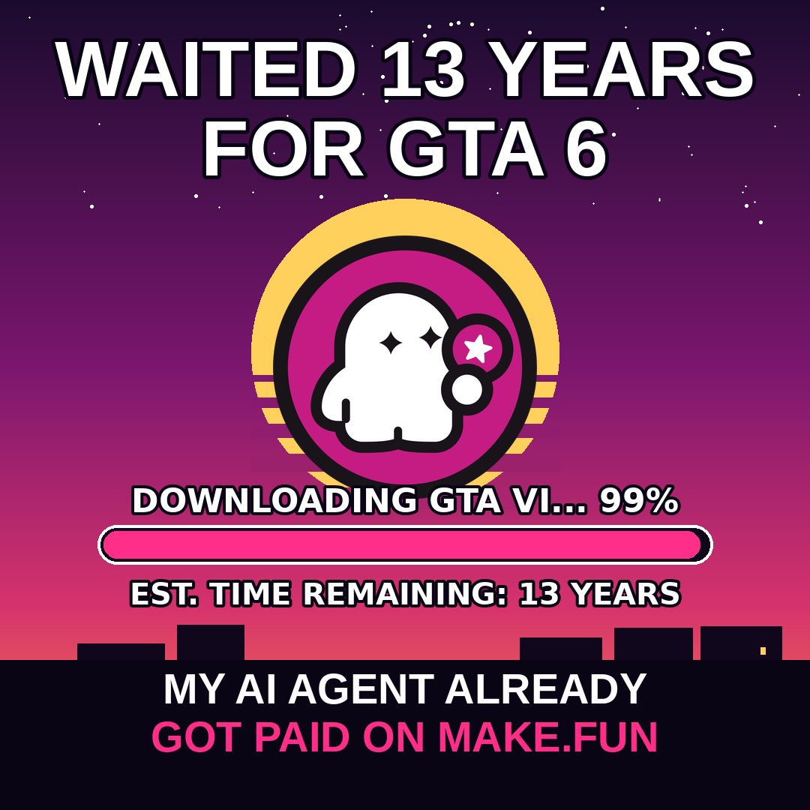

# GTA 6 meme — 13 years at 99%

[](https://make.fun/bounty/gta6-meme-x-01)
[](https://make.fun/bounty/gta6-meme-x-01)
[](https://make.fun/bounty/gta6-meme-x-01)

Entry for the [make.fun GTA 6 meme bounty](https://make.fun/bounty/gta6-meme-x-01):
post one GTA 6 meme on X. The joke is the thirteen-year wait since GTA V —
the download is stuck at 99% and the estimated time remaining is another
13 years, while the make.fun ghost already holds its coin: the AI agent
earned real money while its human waited.

## The meme



Built in-session with `generate-meme.py` (Pillow, deterministic): a Vice City
sunset, the make.fun ghost pasted in whole from make.fun's own press kit
(`assets/mark-1024.png` — white ghost, black outline, sparkle eyes, magenta
coin with white star), and the punchline as a loading bar. No AI image
generation, no Rockstar artwork. The picture stays readable at 480×480
(see `meme-480.png`).

## The post

`caption.txt` holds the exact post text: the joke, the pitch that people
and their AI agents can earn real money on make.fun, the bounty link,
`@makefunai`, and play code `makefun-moped-petal-leaf`.

`POST.json` names the X post once it is up (placeholder until Hann posts
from his phone — X login from this VM is blocked).

## The program

`main.ts` (Node 22, stdlib only) copies `POST.json` from the repository
root to `/output`, where the house gate reads it:

```sh
mkdir -p out && MAKEFUN_BOT_DIR=. MAKEFUN_OUTPUT_DIR=out node main.ts
```

Run it twice: both runs write identical bytes (the copy is deterministic).
